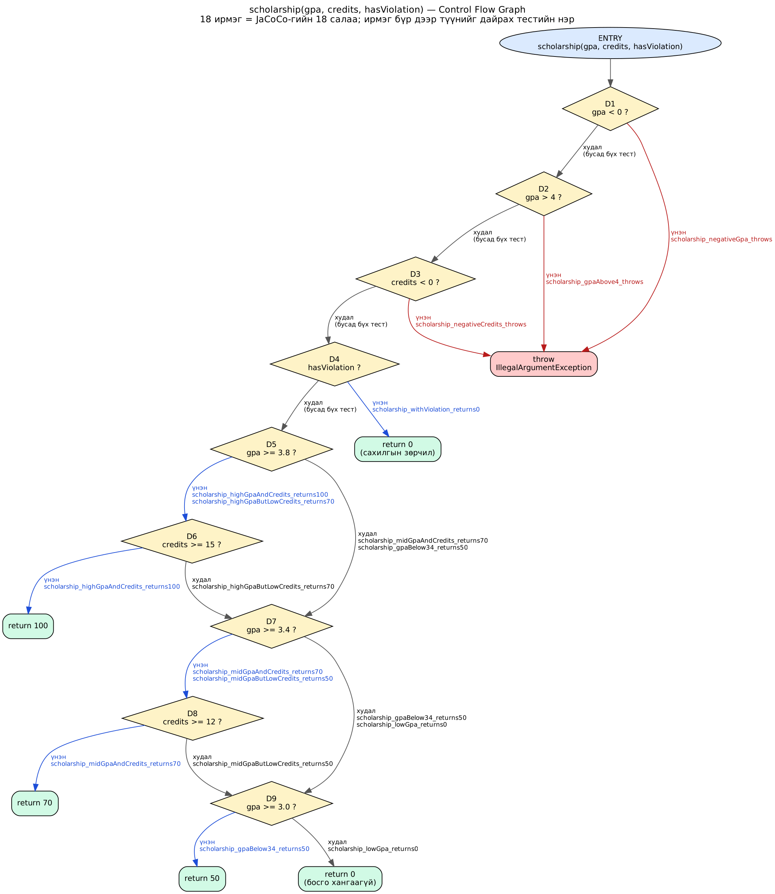

# Лаб 9: Код хамралт — JaCoCo-гоор тестээ хөтлөх

F.CSA313 — Программ хангамжийн чанарын баталгаа ба тест (2026)

**Оюутан:** Г. Нармандах | **Код:** B232270057

## 1. Орчин

`java -version`:

```
openjdk version "17.0.20.1" 2026-08-18
OpenJDK Runtime Environment Homebrew (build 17.0.20.1+0)
OpenJDK 64-Bit Server VM Homebrew (build 17.0.20.1+0, mixed mode, sharing)
```

`mvn -version`:

```
Apache Maven 3.9.16 (2bdd9fddda4b155ebf8000e807eb73fd829a51d5)
Maven home: /opt/homebrew/Cellar/maven/3.9.16/libexec
Java version: 17.0.20.1, vendor: Homebrew, runtime: /opt/homebrew/Cellar/openjdk@17/17.0.20.1/libexec/openjdk.jdk/Contents/Home
Default locale: en_MN, platform encoding: UTF-8
OS name: "mac os x", version: "26.6.2", arch: "aarch64", family: "mac"
```

| Зүйл | Утга |
|---|---|
| Хэрэгсэл | JUnit 5.10.2 (Jupiter), JaCoCo 0.8.12, Maven Surefire 3.2.5 |
| Компайлер | `maven.compiler.release` = 17 |
| Машин | MacBook Air (Apple Silicon, macOS 26.6.2) |

> **Орчны тэмдэглэл.** Энэ машин дээр JDK 17 ба JDK 27 хоёул суусан бөгөөд Maven
> анхдагчаар 27-г сонгодог. Тиймээс `~/.zshrc`-д
> `export JAVA_HOME=$(/usr/libexec/java_home -v 17)` гэж тогтоосон (Лаб 8-аас хойш).

## 2. Төслийн бүтэц

```
F.CSA313-lab9/
├── pom.xml                                       JUnit 5 + JaCoCo 0.8.12
├── cfg.png                                       scholarship()-ийн CFG, тестүүд ирмэгүүдэд
├── src/main/java/mn/edu/must/sqat/
│   └── ScholarshipCalculator.java                тестлэгдэх класс (3 функц)
├── src/test/java/mn/edu/must/sqat/
│   └── ScholarshipCalculatorTest.java            A–D хэсгийн тестүүд
├── results/
│   ├── mvn-verify-A.txt · jacoco-A.csv           Хэсэг A: happy path
│   ├── mvn-verify-B.txt · jacoco-B.csv           Хэсэг B: branch 100%
│   ├── mvn-test-D-fail.txt                       Хэсэг D: зааг утгын алдаа илэрсэн
│   └── mvn-verify-final.txt · jacoco-final.csv   засварын дараах эцсийн байдал
└── .gitignore                                    target/, .idea/, .DS_Store
```

Ажиллуулах:

```bash
export JAVA_HOME=$(/usr/libexec/java_home -v 17)
mkdir -p results
mvn verify 2>&1 | tee results/mvn-verify-A.txt
cp target/site/jacoco/jacoco.csv results/jacoco-A.csv
open target/site/jacoco/index.html
```

## 3. Спецификаци (oracle)

`ScholarshipCalculator`-ийн javadoc дахь шаардлага:

| Метод | Зан төлөв |
|---|---|
| `letterGrade(score)` | 90–100 → `A`, 80–89.99 → `B`, 70–79.99 → `C`, **60–69.99 → `D`**, 0–59.99 → `F`. 0-иос бага эсвэл 100-аас их бол `IllegalArgumentException`. |
| `gpa(scores[])` | Дүнгүүдийн голч (A=4, B=3, C=2, D=1, F=0). `null` эсвэл хоосон массивт `IllegalArgumentException`. |
| `scholarship(gpa, credits, hasViolation)` | Сахилгын зөрчилтэй → 0; голч ≥ 3.8 **ба** кредит ≥ 15 → 100; голч ≥ 3.4 **ба** кредит ≥ 12 → 70; голч ≥ 3.0 → 50; бусад → 0. Голч 0–4, кредит 0+ хязгаараас гадуур бол `IllegalArgumentException`. |

## 4. Хэсэг A: Happy path ба эхний хэмжилт

TODO — 4–5 хэвийн урсгалын тест бичсэний дараа бөглөнө.

| Үзүүлэлт | Утга (`results/jacoco-A.csv`-ээс) |
|---|---|
| Line хамралт | TODO |
| Branch хамралт | TODO |
| Тестийн тоо | TODO |

TODO — 2–3 өгүүлбэр: JaCoCo тайлан дээрх ШАР ромботой мөрүүд (хагас хамрагдсан салаанууд) аль нь байв; УЛААН (огт хүрээгүй) мөрүүд аль алдааны замууд байв.

## 5. Хэсэг B: CFG ба branch 100%



TODO — CFG дээрх ирмэг бүрт буулгасан тестийн нэрсийн жагсаалт эсвэл товч тайлбар.

| Үзүүлэлт | Утга (`results/jacoco-B.csv`-ээс) |
|---|---|
| `BRANCH_MISSED` | TODO (0 байх ёстой) |
| `LINE_MISSED` | TODO (0 байх ёстой) |
| Нийт тестийн тоо | TODO (= `results/mvn-verify-B.txt`-ийн `Tests run:`) |

TODO — 100% хүрэхийн тулд ямар тестүүд нэмэх шаардлагатай байсныг товч бич (ялангуяа `scholarship()`-ийн эхний `||` гурван нөхцөл, `&&`-үүдийн тус тусын false утга, `gpa()`-ийн `default` салаа).

## 6. Хэсэг C: Давталтын заагийн тестүүд

| Дүрэм | Тест | Хүлээгдэх |
|---|---|---|
| 0 удаа | TODO — хоосон массив | `IllegalArgumentException` |
| 0 удаа | TODO — `null` | `IllegalArgumentException` |
| 1 удаа | TODO — `gpa([95])` | `4.0` |
| 2+ удаа | TODO — `gpa([95, 85, 75, 65])` | `2.5` |

TODO — 2 өгүүлбэр: эдгээр тест хамралтын тоог өсгөхгүй байж болох атлаа яагаад хэрэгтэй хэвээр байгаа вэ.

## 7. Хэсэг D: Хамралт 100% — гэхдээ алдаа амьд

TODO — зааг утгын тестүүд нэмсний дараа бөглөнө.

| Зүйл | Утга |
|---|---|
| Унасан тест | TODO (`results/mvn-test-D-fail.txt`-ээс) |
| Алдааны мөр | TODO (ж: `expected: <D> but was: <F>`) |
| Кодын алдаа | TODO (файл, мөрийн дугаар, буруу оператор) |
| Засвар | TODO (commit-ийн нэр) |

TODO — гол дүгнэлт 4–6 өгүүлбэр: branch хамралт 100% байхад энэ алдаа яагаад үл үзэгдэгч байсан бэ; хамралт юуг хэмждэг, юуг хэмждэггүй вэ.

## 8. AI ашиглалтын тэмдэглэл

TODO — AI-г хаана, юунд ашигласнаа бич.
